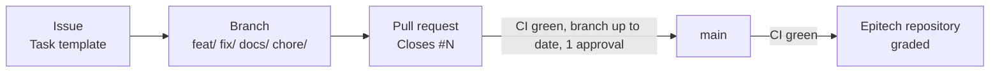

# How to contribute

Developer setup, git flow, and how to extend the product. Running the product: [`README.md`](README.md).

## 1. Setup

Needs Git, Node.js 26 and, once the stack exists, Docker Compose v2. [mise](https://mise.jdx.dev) installs the pinned tools (`mise.toml`: Node, gitleaks, actionlint, shellcheck); without gitleaks, the pre-commit hook falls back to a short regex list.

```bash
git clone git@github.com:Nexlein/Area-Flow.git && cd Area-Flow
mise install   # optional
npm install    # repo tooling and git hooks
```

## 2. Git flow



- `main` only changes through a pull request: CI green, branch up to date, the other member's approval, conversations resolved. No force-push, no deletion.
- Commits: [Conventional Commits](https://www.conventionalcommits.org), `type(scope): subject` with `type` in `feat fix docs style refactor perf test build ci chore revert` (the `commit-msg` hook checks it). Never `--no-verify`.
- Never push to the Epitech repository by hand: the mirror only fast-forwards and would stop.
- `.claude/codemap.md` conflicts, or is stale after GitHub's "Update branch" (no hook runs there): `npm run codemap`, then commit.

## 3. Automation

| Hook or command   | When                | Does                                                                       |
| ----------------- | ------------------- | -------------------------------------------------------------------------- |
| `pre-commit`      | each commit         | Secret scan (gitleaks, `.env` blocked), Prettier on staged files, code map |
| `commit-msg`      | each commit         | Conventional Commits check                                                 |
| `pre-push`        | each push           | `npm run check`                                                            |
| `npm run check`   | pre-push, CI        | Formatting of tracked files, typecheck, tests                              |
| `npm run format`  | by hand             | Prettier on tracked files (untracked ones are left alone)                  |
| `npm run codemap` | pre-commit, by hand | Regenerates `.claude/codemap.md` from the git index                        |
| `npm test`        | `check`             | Tests of the repo scripts (`node --test`, TypeScript run by Node)          |

Repo tooling is TypeScript only, run by Node 26 without a build. Server, web and mobile commands come with the stack.

## 4. When you change…

| You change                   | Also update                                                                                                         |
| ---------------------------- | ------------------------------------------------------------------------------------------------------------------- |
| A technical choice           | An ADR from [`docs/adr/0000-template.md`](docs/adr/0000-template.md), indexed                                       |
| An endpoint the clients call | The OpenAPI description, errors included, in the same PR                                                            |
| Behavior                     | [`docs/architecture/`](docs/architecture/README.md); a feature's row in [`docs/features/`](docs/features/README.md) |
| A SEC feature                | Its evidence note from [`docs/security/0000-template.md`](docs/security/0000-template.md)                           |
| The plan                     | The changes table of [`docs/plan/README.md`](docs/plan/README.md)                                                   |

Code, comments, commits and docs: English. Every source file opens with a comment whose first sentence is its purpose (the code map shows it).

## 5. Epitech mirror (maintainer)

After CI passes on a push to `main`, [`mirror.yml`](.github/workflows/mirror.yml) pushes `main` to `EpitechPGE3-2026/G-YEP-500-MPL-5-1-area-1`. Students are not admin there, so no deploy key: it uses an SSH key of the owner's GitHub account (title "GitHub Action Mirror"), private half in the Actions secret `SSH_PRIVATE_KEY`.

> **Warning:** that key can push to every repository of the owner's account. Never print it; revoke it in GitHub settings if a copy is lost.

To replace the key: `ssh-keygen -t ed25519 -f mirror -N ""`, add `mirror.pub` to the account's SSH keys, `gh secret set SSH_PRIVATE_KEY --repo Nexlein/Area-Flow < mirror`, delete both files, revoke the old key, then re-run the last CI run of `main` (`gh run rerun <id>`; a manual run does not mirror).

## 6. Extending the product

Written once the engine exists, reproducible as is: with ENG-EXT, a trivial node type is added from it during the defense.

| Add a…             | To write: files, interface, registration, published keys, tests    |
| ------------------ | ------------------------------------------------------------------ |
| Service            | TBD (including its OAuth2 subscription and its `about.json` entry) |
| Action             | TBD (including how its hook detects and identifies occurrences)    |
| REAction           | TBD (including parameters, side effects, retries)                  |
| Workflow node type | TBD (validation and execution; what must not change in the engine) |
