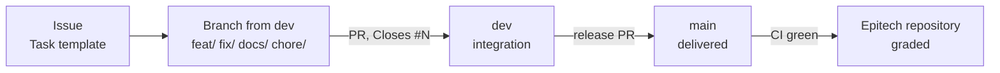

# How to contribute

Developer setup, git flow, and how to extend the product. Running the product: [`README.md`](README.md).

## 1. Setup

Needs Git, Node.js 26 and, once the stack exists, Docker Compose v2. [mise](https://mise.jdx.dev) installs the tools of `mise.toml` (Node 26, exact versions of gitleaks, actionlint and shellcheck); without gitleaks, the pre-commit hook falls back to a short regex list.

```bash
git clone git@github.com:Nexlein/Area-Flow.git && cd Area-Flow
mise install   # optional
npm install    # repo tooling; points git at the hooks in .husky/
```

In a new git worktree, run `npm ci` once: the hooks already run there, but `pre-commit` stops until the dependencies exist.

## 2. Git flow



| Branch | Receives                                             | Rules (rulesets)                                                                                                                |
| ------ | ---------------------------------------------------- | ------------------------------------------------------------------------------------------------------------------------------- |
| `dev`  | Feature PRs, Dependabot and Renovate version updates | PR only · CI green · branch up to date · 1 approval of the last push · conversations resolved · no force-push or deletion       |
| `main` | Release PRs from `dev`; Dependabot security updates  | Same, except the branch need not be up to date (a release PR is already tested on `dev`); CI rejects a PR from any other branch |

- **Release:** before every milestone deadline, a PR `dev` → `main`, merged with a merge commit. Only `main` reaches the Epitech repository.
- **Back-merge:** after anything lands on `main` without coming from `dev` (a Dependabot security update), merge `main` back into `dev` through a branch, since a pull request from `main` itself is never up to date with `dev`: `git switch -c chore/back-merge origin/dev`, `git merge origin/main`, push, then a PR into `dev` titled `chore(release): merge main back into dev`.
- **Merge method:** release and back-merge PRs always use a merge commit, never squash, or the branches diverge. Feature PRs: squash if one commit, merge commit otherwise. Rebase merging is disabled.
- **PR title:** becomes the commit message (squash or merge), so it follows Conventional Commits too, checked by CI with the `commit-msg` rule. Rename Dependabot security PRs, e.g. `fix(deps): ...`. Releases: `chore(release): ...`.
- **`Closes #N`:** written in the PR description, it is copied into that commit; the issue closes when the change reaches `main` with the next release.
- **Admin:** the repository admin may bypass the approval, only by merging a pull request. The required CI check has no bypass: nobody merges a red pull request.
- **Commits:** [Conventional Commits](https://www.conventionalcommits.org), `type(scope): subject`, `type` in `feat fix docs style refactor perf test build ci chore revert` (the `commit-msg` hook checks it). Never `--no-verify`.
- **Epitech repository:** never push by hand: the mirror only fast-forwards and would stop.
- **`.claude/codemap.md`:** if it conflicts, or is stale after GitHub's "Update branch" (no hook runs there), run `npm run codemap`, then commit.

## 3. Automation

| Hook or command   | When                    | Does                                                                                                                                                                                  |
| ----------------- | ----------------------- | ------------------------------------------------------------------------------------------------------------------------------------------------------------------------------------- |
| `pre-commit`      | each commit             | Secret scan (gitleaks with `.gitleaks.toml`, `.env` blocked), Prettier on staged files, code map                                                                                      |
| `commit-msg`      | each commit             | Conventional Commits check                                                                                                                                                            |
| `pre-push`        | each push               | `npm run check`                                                                                                                                                                       |
| `npm run check`   | pre-push, CI            | Formatting of tracked files, typecheck, tests                                                                                                                                         |
| `npm run format`  | by hand                 | Prettier on tracked files (untracked ones are left alone)                                                                                                                             |
| `npm run codemap` | pre-commit, by hand     | Regenerates `.claude/codemap.md` from the git index                                                                                                                                   |
| `npm test`        | `check`                 | Tests of the repo scripts, the secret scan and the `commit-msg` hook (`node --test`, TypeScript run by Node)                                                                          |
| CI (`ci.yml`)     | each PR, push to `main` | PR title and commit messages, PR into `main` only from `dev` or Dependabot, gitleaks over the full history, actionlint, shellcheck on the hooks, `npm run check`, code map up to date |

Repo tooling is TypeScript only, run by Node 26 without a build. Server, web and mobile commands come with the stack.

On GitHub's side (repository settings): secret scanning with push protection, Dependabot alerts and security updates, CodeQL code scanning (default setup: TypeScript and workflows), actions required to be pinned by commit SHA, and private vulnerability reporting.

## 4. When you change…

| You change                   | Also update                                                                                                         |
| ---------------------------- | ------------------------------------------------------------------------------------------------------------------- |
| A technical choice           | An ADR from [`docs/adr/0000-template.md`](docs/adr/0000-template.md), indexed                                       |
| An endpoint the clients call | The OpenAPI description, errors included, in the same PR                                                            |
| Behavior                     | [`docs/architecture/`](docs/architecture/README.md); a feature's row in [`docs/features/`](docs/features/README.md) |
| A SEC feature                | Its evidence note from [`docs/security/0000-template.md`](docs/security/0000-template.md)                           |
| The plan                     | The changes table of [`docs/plan/README.md`](docs/plan/README.md)                                                   |
| A client screen              | Both languages present, the WCAG AA check of [`docs/accessibility/audit.md`](docs/accessibility/audit.md)           |

Code, comments, commits and docs: English. Every source file opens with a comment whose first sentence is its purpose; a Markdown file gives it in its first heading, or in a leading `<!-- -->` comment (the code map shows it).

## 5. Epitech mirror (maintainer)

- After CI passes on a push to `main`, [`mirror.yml`](.github/workflows/mirror.yml) pushes `main` to `EpitechPGE3-2026/G-YEP-500-MPL-5-1-area-1`.
- Students are not admin there, so no deploy key: it uses an SSH key of the owner's GitHub account (title "GitHub Action Mirror"), private half in the secret `SSH_PRIVATE_KEY` of the **`epitech-mirror` environment**.
- That environment only deploys from `main`: a workflow pushed on any other branch cannot read the key, and `main` needs an approved pull request.
- The mirror copies the workflows too, but Actions cannot start in the Epitech repository (no minutes): every job excludes the `EpitechPGE3-2026` organization and is skipped there.
- Dependabot also reads the copied config there, and finds no `dev` branch to target.

> **Warning:** that key can push to every repository of the owner's account. Never print it, never store it as a repository secret; revoke it in GitHub settings if a copy is lost.

To replace the key:

1. Generate a key pair:

   ```bash
   ssh-keygen -t ed25519 -f area-mirror -N ""
   ```

2. Add `area-mirror.pub` to the account's SSH keys.
3. Store the private half in the environment secret:

   ```bash
   gh secret set SSH_PRIVATE_KEY --env epitech-mirror --repo Nexlein/Area-Flow < area-mirror
   ```

4. Delete both files (`area-mirror`, `area-mirror.pub`); until then `.gitignore` keeps them out of git.
5. Revoke the old key.
6. Re-run the last CI run of `main` (a manual run does not mirror):

   ```bash
   gh run rerun <id>
   ```

## 6. Extending the product

Written once the engine exists, reproducible as is: with ENG-EXT, a trivial node type is added from it during the defense.

| Add a…             | To write: files, interface, registration, published keys, tests    |
| ------------------ | ------------------------------------------------------------------ |
| Service            | TBD (including its OAuth2 subscription and its `about.json` entry) |
| Action             | TBD (including how its hook detects and identifies occurrences)    |
| REAction           | TBD (including parameters, side effects, retries)                  |
| Workflow node type | TBD (validation and execution; what must not change in the engine) |
