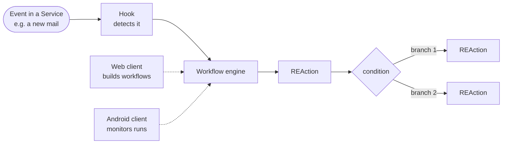

# Area-Flow

> Development, pull requests and CI live on [Nexlein/Area-Flow](https://github.com/Nexlein/Area-Flow) (badges above). The Epitech repository is a mirror of its `main` branch, updated after each release; GitHub Actions cannot run there, so our workflow runs show as skipped (the "Dependabot Updates" runs there are managed by GitHub).

Epitech Tek3 AREA project: an automation platform inspired by IFTTT and Zapier. Users connect their accounts on third-party Services; an Action detected in one Service triggers REActions in others.

**Status:** Milestone 1 (Plan), stack being chosen: [`docs/plan/`](docs/plan/README.md).

## Glossary

| Term     | Meaning                                                                        |
| -------- | ------------------------------------------------------------------------------ |
| Service  | A third-party platform the user subscribes to (often through OAuth2)           |
| Action   | An event in a Service that the product detects                                 |
| REAction | A task the product performs in a Service                                       |
| Hook     | What detects an Action and starts the workflows, with no client open           |
| AREA     | The smallest workflow: one Action, one REAction                                |
| Workflow | A trigger, a chain of reactions, at most one condition with two branches       |
| Key path | A reference to a value an earlier node published, e.g. `{{ trigger.subject }}` |
| Builder  | The web screen where workflows are assembled                                   |

## Setup

To be written with the stack. Target: one Docker Compose command builds and runs everything.

| Endpoint or artifact             | Where |
| -------------------------------- | ----- |
| Server API                       | TBD   |
| OpenAPI description and UI       | TBD   |
| Service catalogue (`about.json`) | TBD   |
| Web client                       | TBD   |
| Android APK                      | TBD   |

## Operation

Create an account, subscribe to a Service, build a workflow, follow its runs: TBD.

## Public API

An OpenAPI description with a browsable interface, served by the server (URL TBD), covering every endpoint the clients call, errors included; a test checks it against the code.

## Services, Actions and REActions

| Service | Auth | Actions | REActions |
| ------- | ---- | ------- | --------- |

| Count (on the less complete client) | Now | Minimum (M = 4) |
| ----------------------------------- | --- | --------------- |
| Services S                          | 0   | 5               |
| … of which via OAuth2               | 0   | 3               |
| Actions + REActions                 | 0   | 10              |

Feature difficulty D: [`docs/plan/features-selection.md`](docs/plan/features-selection.md).

## More

| Folder or file                             | What                                                           |
| ------------------------------------------ | -------------------------------------------------------------- |
| [`HOWTOCONTRIBUTE.md`](HOWTOCONTRIBUTE.md) | Setup for developers, git flow, extending the product          |
| [`docs/`](docs/README.md)                  | Subject, plan, architecture, ADRs, features, security, defense |
| `.github/`, `.husky/`, `scripts/`          | CI and mirror, git hooks, repo tooling (TypeScript)            |
| `.claude/`, `CLAUDE.md`                    | Agent settings, formatting hook, generated code map            |

Team: Nexlein, Saitamadupauvre, TeddyBertrand, Quinceyyyy.
