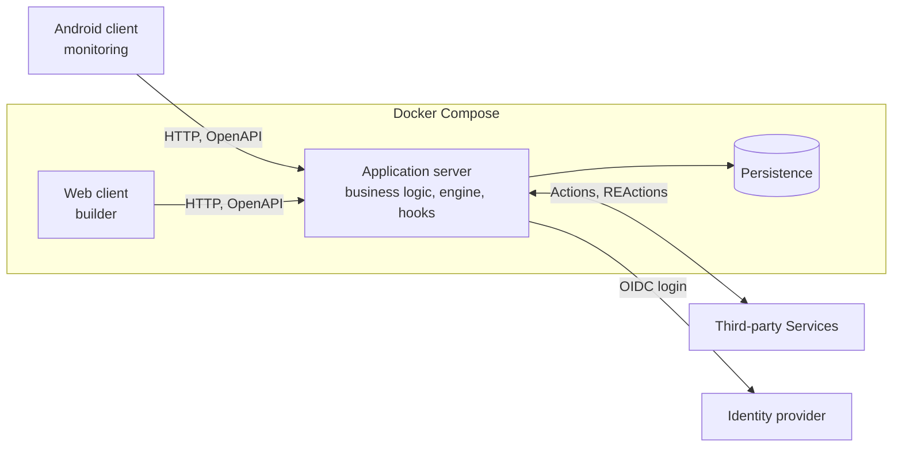

# Architecture

**Status:** to design once the stack is chosen ([`../plan/`](../plan/README.md)); first version due at the MVP. Applies to every file of this folder.

## Components

Boundaries fixed by the subject; what runs in each box is decided in the ADRs.

## API contract

The OpenAPI description is the contract between client and server members.

| Question                                                  | Answer |
| --------------------------------------------------------- | ------ |
| Written first (contract-first) or generated from the code | ADR    |
| Served at, with its browsable interface                   |        |
| Test that fails when code and description disagree        |        |
| Error format shared by every endpoint                     |        |

## Documents

| Document                                       | Covers                                                                 |
| ---------------------------------------------- | ---------------------------------------------------------------------- |
| [`workflow-model.md`](workflow-model.md)       | Nodes, validation at save, key paths, run lifecycle, failure semantics |
| [`persistence-model.md`](persistence-model.md) | Entities, relations, data structures, retention                        |
| [`auth.md`](auth.md)                           | Local accounts, OIDC login, identity linking, OAuth2, token lifecycle  |
| [`hooks.md`](hooks.md)                         | Action detection, event identity and deduplication, scheduling         |
| [`service-discovery.md`](service-discovery.md) | `about.json` schema and versioning                                     |
