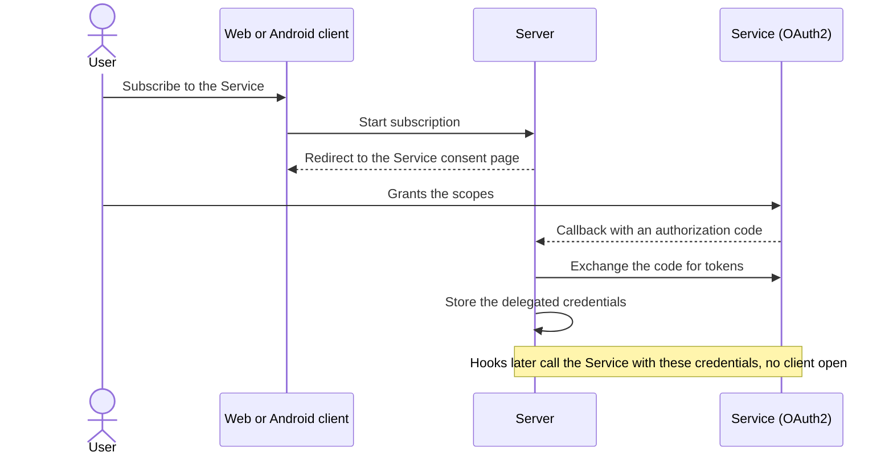

# Authentication and delegated access

The subject asks us to document identity linking and the lifecycle of delegated credentials. OIDC = login (who the user is); OAuth 2.0 = subscriptions (what we may do in a Service).

Subscribing to a Service, the flow every hook relies on:

## Decisions

| Question                                                                     | Answer |
| ---------------------------------------------------------------------------- | ------ |
| Account confirmation; what an unconfirmed account can do                     |        |
| Password storage: algorithm and parameters                                   |        |
| Session or token given to the clients: format, lifetime, storage, revocation |        |
| OIDC providers                                                               |        |
| Redirects and callbacks on web and Android (state, PKCE)                     |        |
| Linking an external identity: first login, email already used, unlinking     |        |
| Scopes requested per Service, and why each                                   |        |
| Where delegated credentials live, how they are protected                     |        |
| Refresh, expiry, revocation; hooks when a token stops working                |        |
| Account deletion: what happens to the credentials                            |        |

A third-party token is never sent to a client and never logged.
