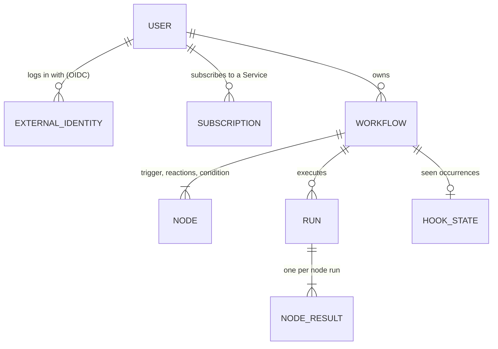

# Persistence model and data structures

Draft drawn from the subject; fields and final shape come with the persistence choice ([`../plan/tech-persistence.md`](../plan/tech-persistence.md)).

| Entity            | Note                                                                    |
| ----------------- | ----------------------------------------------------------------------- |
| USER              | Password storage: algorithm, parameters                                 |
| EXTERNAL_IDENTITY | Linking rules: [`auth.md`](auth.md)                                     |
| SUBSCRIPTION      | Delegated credentials, scopes, expiry; protection: [`auth.md`](auth.md) |
| NODE              | No structural maximum on reactions                                      |
| HOOK_STATE        | Deduplication: [`hooks.md`](hooks.md)                                   |
| RUN               | Retention below                                                         |

- **Data structures** asked at the defense: how a workflow graph is stored, how key paths resolve, how an event is identified.
- **Migrations:** how the schema is versioned and applied on a fresh clone.

## Retention

| Data | Kept for | Why | Enforced by |
| ---- | -------- | --- | ----------- |
