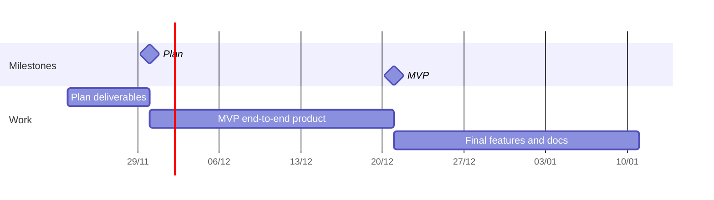
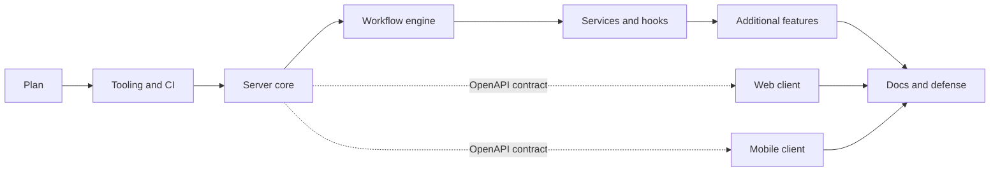

# Task breakdown

One GitHub issue per task ([Nexlein/Area-Flow](https://github.com/Nexlein/Area-Flow/issues), "Task" template): goal, "Done when", owner, due date, estimate, dependencies as "blocked by". Each issue has a GitHub milestone (Plan, MVP, Final) and an epic. This file is the overview; the issues hold the detail.

## Timeline

The only place for the dates. Start assumed on 2026-11-23 (subject download): confirm on the intranet.

Final date: to set (the bar above is a placeholder).

## Epics

Proposed from the subject, to adjust once the stack is chosen.

| Epic                | Covers                                                              | Owner | Issue |
| ------------------- | ------------------------------------------------------------------- | ----- | ----- |
| Plan                | Technology selections, features, architecture questions, management |       |       |
| Tooling and CI      | CI (lint, tests, build), Docker Compose stack, automated deployment |       |       |
| Server core         | HTTP API and OpenAPI, accounts, local and OIDC login                |       |       |
| Workflow engine     | Model, validation at save, key paths, execution, failure semantics  |       |       |
| Services and hooks  | OAuth2 subscriptions, Actions, REActions, hooks, `about.json`       |       |       |
| Web client          | Login, subscriptions, builder, runs, i18n, WCAG AA                  |       |       |
| Mobile client       | Server address, login, workflows on/off, runs, i18n, WCAG AA, APK   |       |       |
| Additional features | One sub-epic per selected feature                                   |       |       |
| Docs and defense    | README, HOWTOCONTRIBUTE, architecture, audit, post-mortem, demo     |       |       |

## Balance

Checked at each milestone: work spread fairly (subject).

| Member          | Tasks | Estimate |
| --------------- | ----- | -------- |
| Nexlein         |       |          |
| Saitamadupauvre |       |          |
