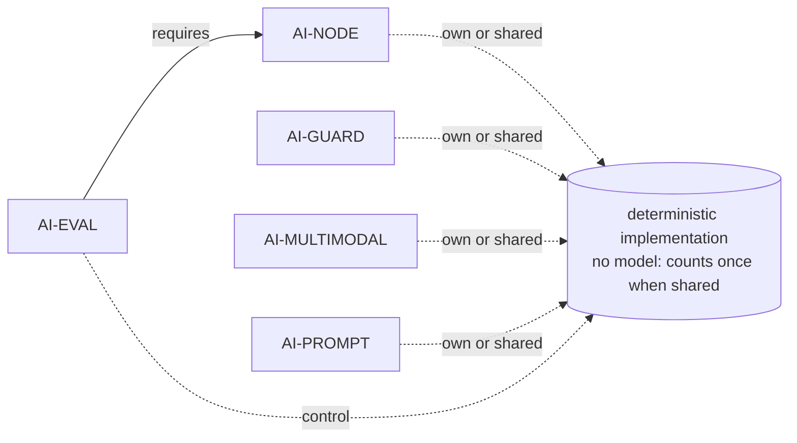

# Additional features catalogue (condensed)

Source: [`area-additional_features.pdf`](area-additional_features.pdf) (v6.4.0). Selection rules: [`SUBJECT.md`](SUBJECT.md#additional-features). Our selection: [`../plan/features-selection.md`](../plan/features-selection.md); where each criterion is observed: [`../features/README.md`](../features/README.md).

- A feature is delivered only when every criterion below can be observed.
- A criterion met by a document needs claims we can demonstrate live; a document nobody in the group can defend is not a deliverable.
- Each SEC feature also needs an evidence note: attack scenario, reproduction, observation, protection and where it lives, protected result, limits ([`../security/`](../security/README.md)).
- Dependencies: only AI-EVAL requires another feature (AI-NODE; both count). AI-GUARD, AI-MULTIMODAL, AI-PROMPT and AI-REVIEW do not require AI-NODE. A deterministic (no model) implementation shared by AI-NODE, AI-GUARD, AI-MULTIMODAL and AI-PROMPT counts once; AI-EVAL measures against it as its control.

Solid arrow: requires. Dotted arrow: needs a deterministic implementation, its own or a shared one.

"Need" restates the customer's quote in our words; the bullets are the definition of done.

| Id                              | Topic                         | Difficulty |
| ------------------------------- | ----------------------------- | ---------- |
| [AI-EVAL](#ai-eval)             | Model evaluation              | 2          |
| [AI-GUARD](#ai-guard)           | Prompt injection defense      | 2          |
| [AI-MULTIMODAL](#ai-multimodal) | Multimodal inputs             | 2          |
| [AI-NODE](#ai-node)             | Autonomous AI node            | 3          |
| [AI-PROMPT](#ai-prompt)         | Prompt versioning             | 1          |
| [AI-REVIEW](#ai-review)         | Human validation              | 2          |
| [ENG-ADMIN](#eng-admin)         | Administration area           | 2          |
| [ENG-ADR](#eng-adr)             | Architecture decision records | 1          |
| [ENG-ASYNC](#eng-async)         | Asynchronous execution        | 3          |
| [ENG-EXT](#eng-ext)             | Extensible connectors         | 2          |
| [ENG-RETRY](#eng-retry)         | Retries and idempotency       | 2          |
| [ENG-TEMPLATES](#eng-templates) | Shareable templates           | 3          |
| [SEC-AUTH](#sec-auth)           | Authentication hardening      | 2          |
| [SEC-CRYPTO](#sec-crypto)       | Encryption at rest            | 2          |
| [SEC-DEPS](#sec-deps)           | Dependency scanning           | 1          |
| [SEC-GDPR](#sec-gdpr)           | Personal data compliance      | 2          |
| [SEC-SSRF](#sec-ssrf)           | SSRF protection               | 2          |
| [SEC-THREAT](#sec-threat)       | Threat modeling               | 3          |
| [SYS-BACKUP](#sys-backup)       | Backup and restore            | 2          |
| [SYS-HEALTH](#sys-health)       | Health checks                 | 1          |
| [SYS-K8S](#sys-k8s)             | Container orchestration       | 3          |
| [SYS-OBS](#sys-obs)             | Observability                 | 3          |
| [SYS-RELEASE](#sys-release)     | Release automation            | 2          |
| [SYS-SECRETS](#sys-secrets)     | Secrets management            | 1          |

## AI

### AI-EVAL

**Model evaluation (2).** Need: measure the behavior we claim instead of calling it intelligent. Requires AI-NODE.

- A committed labelled set of at least 15 examples, saying how and by whom the labels were made.
- A reproducible command computes a metric that fits the use case; the evaluator runs it.
- The measurement runs against the deterministic implementation as a stable control.
- At least two dated measurements make a change visible and name the evaluated model.
- The docs link the client need, the implementation, the metric and its limits, weaknesses of the labelled set included.

### AI-GUARD

**Prompt injection defense (2).** Need: outside text must not steer the AI, and employee names must not reach the model provider.

- A committed corpus of at least 20 attack payloads, each with the effect it attempts. One command runs them through the node and reports, per payload, that the declared keys are unchanged and the effect did not happen.
- Third-party content is never treated as an instruction; the evaluator follows one payload to the side of the boundary where it lands.
- The personal data categories the node removes are a fixed, documented list held in the node configuration.
- Three planted identifiers of those categories are absent from the outbound request, which the evaluator reads before it leaves.
- The node output restores the three identifiers byte for byte.
- Blocked attempts are recorded with their date and originating AREA.
- All shown on an implementation that returns its input unchanged, with no model called. AI-NODE not required.

### AI-MULTIMODAL

**Multimodal inputs (2).** Need: turn the field team's voice notes and photos into something the automation can read.

- A node turns an audio recording or an image produced by an earlier node into text published through key paths, and a later node consumes it.
- The documented representation of non-text payloads matches the data model.
- A deterministic implementation returns the same text twice for the same input, with no model called. AI-NODE not required.
- Stated size and duration limits refuse an oversized payload with a reason naming the limit.
- An unsupported format is refused at the node and ends the run in the documented state, without bringing the chain down.
- Payload retention and location are stated, and verifiable when the payload is kept.

### AI-NODE

**Autonomous AI node (3).** Need: use a language model inside workflows without tying the whole engine to one provider.

- An AI node takes part in the ordinary workflow and key path mechanism.
- Model access sits behind an abstraction with a real and a deterministic implementation; switching between them is configuration.
- Deterministic runs are reproducible with nothing leaving the machine: the evaluator runs the same workflow twice and compares.
- Cost is bounded by documented controls (quota, timeout, size limits), each shown with what the user sees when it is reached.
- Repeated identical work is served without a second outbound call.
- A dry run shows what would be requested without sending it.
- At least two use cases with declared input and output shapes and credible user stories.
- Published keys are declared per instance; a key path to an undeclared key is refused when the workflow is saved.

### AI-PROMPT

**Prompt versioning (1).** Need: when a prompt change breaks things, get the old one back the same evening and compare the two.

- Every instruction sent to a model lives in a versioned artifact outside the source code, with a version identifier and a date.
- The version a node uses is configuration; a rollback applies on the next run without touching the source code.
- One command runs two versions over a committed set of at least 10 inputs and prints the same named measure for each, side by side.
- The command runs with no model available, on a deterministic implementation. Neither AI-NODE nor AI-EVAL required.
- At least two dated comparisons are committed with the version identifiers they compared.

### AI-REVIEW

**Human validation (2).** Need: the product may draft, a person approves, and what happens when nobody answers is defined.

- A review node suspends the run; nothing after it executes.
- A suspended run survives a restart of the application server.
- The web client lists pending reviews with the value produced before them; an approval resumes the chain.
- A value edited before approval is what the following nodes receive through key paths.
- A rejected review ends the run as rejected, distinct from failed.
- An unanswered review reaches the configured terminal state after the configured delay, which the evaluator sets to one minute.
- The mobile client lists pending reviews; acting on them is web only.
- The node calls no model and is shown on a chain producing a constant value. AI-NODE not required.

## ENG

### ENG-ADMIN

**Administration area (2).** Need: support administers the product without opening the database or taking user credentials.

- An administrator role protects an administration area; a normal user is refused.
- Administrators inspect and disable users and services: a disabled user can no longer authenticate, and AREAs depending on a disabled service stop triggering.
- Administrators inspect user AREAs without learning third-party tokens.
- State-changing administrative actions are audited with actor and time.
- With SYS-OBS also selected, the administration area links to execution records instead of duplicating them.

### ENG-ADR

**Architecture decision records (1).** Need: the reasons behind important architecture choices, short.

- At least three significant ADRs committed, one of them about the workflow engine, each saying why it deserved a record.
- Each gives context, real alternatives, the decision and the accepted consequences.
- Alternatives are rejected for this project, not declared bad in general.
- Records are dated and carry a status; superseded ones point to their replacement.
- Any member can say what the product would look like under a rejected option the evaluator picks.

### ENG-ASYNC

**Asynchronous execution (3).** Need: a slow partner must neither block the product nor lose work.

- Workflow execution continues outside the request that triggered it, which answers before the work is finished.
- An existing broker or job queue carries pending work; the choice is justified.
- A worker separate from the application server can be stopped, work queued, then restarted without losing that work.
- Third-party waits are bounded by documented timeouts.
- Worker capacity changes through configuration, not source code.

### ENG-EXT

**Extensible connectors (2).** Need: a new integration must not require rewriting the engine.

- Node implementations follow a common, documented interface covering validation and execution.
- Node types register at startup, isolated from the execution logic, with no dynamic loading of third-party code.
- Adding the last node type did not change the engine: its commit touches only the new node and its registration.
- `HOWTOCONTRIBUTE.md` holds a reproducible procedure, and a trivial node type is added from it during the defense.
- A new Action or REAction appears in `about.json` without a second hard-coded catalogue nor a change to the payload shape.

### ENG-RETRY

**Retries and idempotency (2).** Need: transient errors recover without performing the same side effect several times.

- Failed nodes are retried automatically a bounded number of times with growing delays, stated before the evaluator provokes a failure.
- Retries need no broker; this feature never requires ENG-ASYNC.
- A side-effecting REAction is protected against duplicate effects during retry, and the mechanism is explained.
- Exhausted work is kept in a dead-letter store, where it can be inspected and replayed.
- The evaluator removes the cause of failure and replays a dead-lettered run successfully.
- Retry policy, attempts and delays are configuration.
- The group explains how retry, persistence and idempotency depend on each other in its architecture.

### ENG-TEMPLATES

**Shareable templates (3).** Need: share an automation without sharing credentials.

- A user exports an AREA from the web client as one portable file with no credentials or tokens.
- Another user imports it and binds it to their own service subscriptions.
- A missing subscription is reported by name, and nothing is created.
- A tampered or structurally invalid definition is rejected at import, and nothing is created.
- The format is documented and versioned, with a policy for older versions.

## SEC

### SEC-AUTH

**Authentication hardening (2).** Need: nobody abuses the login callback, and password guessing meets resistance and leaves evidence. Goes beyond the common base: abuse resistance, not just working login.

- Accepted redirect targets follow an exact allow list, documented with who controls it; a close but invalid target is rejected.
- An unsolicited or replayed callback is rejected; the group explains what tells the second attempt apart.
- Authorization code interception is mitigated; the group explains the mechanism and its limits rather than naming it.
- The same protections are shown on the mobile login, not only in the browser.
- Registration and login are rate limited, with documented limits.
- Going over a limit returns the dedicated HTTP status and a retry signal, shown by replaying the attack loop used before the limit existed.
- A legitimate user is never locked out permanently; the recovery behavior is stated.
- Limited attempts are recorded with address and time, never with passwords, and at least two indicators of such an attack are documented.

### SEC-CRYPTO

**Encryption at rest (2).** Need: assume the attacker has the database, and limit what the dump reveals.

- Show what a database dump exposed before encryption, and identify the sensitive data.
- Third-party tokens are encrypted at rest with an authenticated cipher; the evaluator reads ciphertext in the database.
- The key lives outside the source, the repository and the database; its provisioning is documented.
- No token, in clear or encrypted, appears in the logs of a full AREA run.
- Key rotation is documented, including what happens to data encrypted with the previous key.
- A tampered token is detected and refused when the evaluator alters one byte.

### SEC-DEPS

**Dependency scanning (1).** Need: vulnerable dependencies become visible and actionable.

- Dependency vulnerability scanning runs automatically on every contribution, for the server and both clients (pipeline, commit hook or scheduled job).
- A stated severity threshold blocks contributions, shown in the automation history or provoked live with a known vulnerable dependency.
- The current report is reachable, and the group explains its most severe open finding.
- Accepted findings record their rationale and compensating measures.
- The group explains how a newly disclosed vulnerability reaches its attention.

### SEC-GDPR

**Personal data compliance (2).** Need: users can see, export and delete the personal data held on them, without a developer.

- A committed data inventory maps personal data to purpose, storage location and retention.
- An authenticated user exports their data from the web client in a machine-readable file.
- Account deletion leaves no personal data in the database beyond what is documented as deliberately kept, with its justification.
- Account deletion revokes or destroys delegated third-party tokens.
- Retention of execution records is stated and technically enforced.
- What deletion means for backups is documented: rewritten, expired within a stated delay, or replayed on restore.

### SEC-SSRF

**SSRF protection (2).** Need: user-controlled outbound requests must not reach internal targets.

- Before the protection exists, the group shows the attack against a target it controls and states the potential impact.
- User-supplied addresses in private, loopback and reserved ranges are rejected; the evaluator tries at least three.
- A target resolving differently at check time and at connection time is blocked; the mechanism and its limits are documented.
- Redirects are not followed, or are revalidated with the same rules; the choice is documented.
- Accepted schemes follow a documented allow list.
- A blocked call leaves a record an operator can inspect.
- Outbound calls are bounded by a stated timeout and maximum response size; the evaluator sees a slow or oversized target stopped.

### SEC-THREAT

**Threat modeling (3).** Need: a credible attack chain, what we would observe, and what stops it.

- A threat model covers workflow execution and outbound calls, not only login, with a stated method naming assets, entry points and trust boundaries.
- One plausible attack chain is documented step by step, from initial access to impact, in the vocabulary of a recognized attack framework.
- Each step states its mitigation and whether it is implemented today.
- Each step names at least one detection opportunity: what an operator sees, and where.
- The group plays the whole chain against its controlled environment and keeps evidence of each step.
- At least two detection indicators are implemented, and replaying the chain raises them where documented.

## SYS

### SYS-BACKUP

**Backup and restore (2).** Need: prove the backups by restoring one.

- Timestamped database backups run on a schedule and are stored outside the database container.
- One documented command or script restores a backup.
- The evaluator destroys data and sees a successful restore, with the product working on the previous data.
- The worst-case data loss is stated and follows from the schedule.
- Third-party tokens in backups are encrypted, or the docs state what protects them.

### SYS-HEALTH

**Health checks (1).** Need: say which dependency is failing.

- A machine-readable HTTP health endpoint reports each dependency separately: at least the database, the third-party authentication providers and whatever runs the hooks.
- A required dependency failure turns the answer into a failing status.
- The evaluator stops the database container and sees it identified.
- Checks are bounded: the endpoint answers within one second even when a dependency is unreachable.
- No secret, connection string or stack trace is exposed.

### SYS-K8S

**Container orchestration (3).** Need: run on an orchestrated cluster and survive losing one application instance.

- Kubernetes manifests for the whole product are versioned in a dedicated directory: deployments, services, entry point, configuration and secrets.
- The product runs on a local or managed cluster during the defense; the evaluator reaches the web client through its entry point.
- The server runs several replicas and keeps answering when the evaluator deletes one.
- Configuration and secrets come from cluster objects, not from images or container files. This feature carries its own minimal probes and secret wiring, and never requires SYS-HEALTH or SYS-SECRETS.
- The group diagnoses a deliberately broken component with the cluster command line.

### SYS-OBS

**Observability (3).** Need: understand a workflow run after it happened, and see the product's behavior over time.

- Every run writes a persisted record: AREA, user, timing, nodes run with their inputs and outputs, outcome.
- Finished runs are never rewritten, and the enforcement is explained.
- Run count, failure rate and duration are exposed over HTTP in a documented format that a market monitoring tool reads without adaptation.
- A provisioned dashboard comes up with the stack, populated after a few runs, with no manual setup.
- From the web client alone, the evaluator learns how much the product ran over a period and which AREA fails most.
- The history, the metrics and the web views read one single store of execution records.

### SYS-RELEASE

**Release automation (2).** Need: know exactly which version runs, and get yesterday's back in minutes when today's breaks. Extends the base's automated checks and deployment to versioned, traceable, reversible releases.

- Every merge into the main branch builds the server and web client images once, tags them with their source commit and publishes them to a registry; the evaluator pulls one by its tag.
- Pushing a version tag produces a release by automation: it references its published images, carries the installable Android app, and lists a changelog generated from the history since the previous release.
- Deployment runs the published images and never builds on its target; the evaluator matches the version reported by the running product to a release and its commit.
- A deployment whose post-deployment check fails is stopped and the previous release put back without human action, shown in the automation history or provoked live. This check never requires SYS-HEALTH.
- One documented command or action redeploys any earlier release, and the evaluator does it.
- A live status badge in `README.md` shows the state of the main branch and leads to its latest run.

### SYS-SECRETS

**Secrets management (1).** Need: prove secrets do not leak through source, images or logs.

- Secret scanning over the current content and the history is clean, or every historical secret is documented as revoked, with proof.
- A complete `.env.example` documents every required variable with a description and a harmless placeholder.
- A fresh clone configured from the example file starts a running product, and the evaluator does it.
- Secrets reach containers through the environment or an orchestrator secret mechanism, never through committed files or baked images.
- No secret appears in any service log; the evaluator greps a full run.
