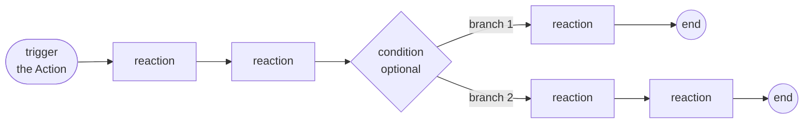

# AREA — Subject (condensed)

Restates the PDFs of this folder, nothing more: [`area-project.pdf`](area-project.pdf) (common base), [`area-additional_features.pdf`](area-additional_features.pdf) (v6.4.0, condensed in [`FEATURES.md`](FEATURES.md)), [`area-security_evidence.pdf`](area-security_evidence.pdf) (v6.3.2, applied in [`../security/0000-template.md`](../security/0000-template.md)). Our decisions: [`../adr/`](../adr/README.md). The PDF wins.

## Spirit

We act as software architects: understand the need, compare alternatives (state of the art), check them with quick demos (proof of concept), decide, integrate existing components, defend the consequences. Our code is mostly the business glue. The hard part: one product that runs on its own, survives its own failures and can be handed over. Every feature answers a real user need.

## Product

| Part               | Subject requirement                                                    |
| ------------------ | ---------------------------------------------------------------------- |
| Application server | Implements every feature; all business logic and rules live here       |
| Web client         | Uses the server from a browser; common browsers                        |
| Mobile client      | Android (iOS is a bonus); the server's network address is configurable |

Full-stack frameworks are strongly discouraged: one codebase blurs the client/server boundary the project requires and makes splitting the work much harder. Clients and server are built in parallel by different members.

## Accounts and delegated access

- Create and confirm an account, then log in: local authentication (username and password) **and** an external identity provider through OpenID Connect (OIDC).
- When a Service must act later for the user, use its own authorization mechanism (usually OAuth 2.0) and store the delegated credentials unattended hooks need.
- Document how external identities link to local users, and the lifecycle of delegated credentials.

| Protocol  | Answers                                  | Used for              |
| --------- | ---------------------------------------- | --------------------- |
| OIDC      | Who the user is                          | Login                 |
| OAuth 2.0 | What the app may do on the user's behalf | Service subscriptions |

One provider can take part in both flows; they solve different problems.

## Services, Actions, REActions

The user picks the Services they hold an account on and subscribes to them. Each Service offers at least two components:

| Component    | What it is                                                                                  |
| ------------ | ------------------------------------------------------------------------------------------- |
| **Action**   | An event inside the Service the product detects (message posted, file added, deadline near) |
| **REAction** | A task the product performs inside a Service once an Action is detected                     |
| **Hook**     | What detects an Action                                                                      |

The server declares the available Services, Actions and REActions and exposes them to the clients. Any Service is allowed; one we use ourselves gets tested more and demos better. A connector is worth its use case, not its place in a count.

## Workflows

The server walks the nodes in order once the Action is detected. An **AREA** (one Action → one REAction) is the smallest workflow.

Bounds of the common base:

1. The normal chain is linear.
2. A condition has two successors.
3. At most one condition, never nested.
4. Branches end the workflow and never merge.
5. Workflows without a condition, or with a single reaction, stay valid.
6. The engine must demo a meaningful workflow with **at least four reaction nodes**; the data model must not make four a structural maximum.
7. Structural validity is checked **when the workflow is saved**.

Cases left open (e.g. is an empty branch valid?) are ours to decide, document and apply consistently. Each workflow we offer should save its user real time or effort.

**Builder** (where users assemble workflows): free form but justified (canvas, step list, form wizard...). **Web only**: nodes and the data mapping between them are edited from the web client alone. The mobile client lists workflows, enables and disables them, shows what they did; no building on mobile.

### Data between nodes

Every node publishes a declared set of values; later nodes reference them with key paths such as `{{ trigger.subject }}` or `{{ node_2.file_id }}`. Required, implementation free:

- each node type declares the keys it may publish;
- a reference outside that declaration is rejected when the workflow is saved;
- a value missing at run time is handled deterministically, following our documented model;
- substitution replaces data only and never evaluates user-supplied code.

### Hooks

Hooks detect Actions and start the matching workflow with no client open, and never treat the same occurrence as a new event again and again. How events are identified, scheduled and persisted is an architecture decision to document and defend.

## Technical requirements

| Topic                 | Requirement                                                                                                                                                                                                                                                                                           |
| --------------------- | ----------------------------------------------------------------------------------------------------------------------------------------------------------------------------------------------------------------------------------------------------------------------------------------------------- |
| **API contract**      | The server serves an OpenAPI description of its HTTP API with a browsable interface: the contract between client and server members. It covers every endpoint the clients call, errors included. A test fails when implementation and description disagree.                                           |
| **Accessibility**     | Both clients meet WCAG level **AA**. A committed audit report states what was measured, with which tool, on which screens, what was fixed, what was left unfixed and why.                                                                                                                             |
| **Languages**         | Both clients in at least two languages over the whole main flow, from registration to creating an AREA.                                                                                                                                                                                               |
| **Docker Compose**    | The whole product builds and runs reproducibly with Docker Compose (container split is ours). Server and web client reachable locally; an installable Android app produced. Docs give the commands and the resulting endpoints and artifacts.                                                         |
| **Service discovery** | While running, the server exposes a machine-readable description of Services, Actions and REActions (identifiers, descriptions, parameters): clients never hard-code the catalogue. Schema is ours: documented, versionable, consistent with what clients offer. The catalogue calls it `about.json`. |

## Additional features

24 features, with their acceptance criteria: [`FEATURES.md`](FEATURES.md). Each has a domain (AI, ENG, SEC, SYS) and a difficulty: 1 small, 2 medium, 3 large, testing and docs included.

- Chosen and justified at milestone 1, revisable once at milestone 2, then frozen and graded at milestone 3.
- Choose against the group's weaknesses rather than for comfort, across several domains when possible.
- Much harder than estimated: tell the local manager early, while the selection can still change, and say it again in the post-mortem.
- Delivered only when **all** acceptance criteria can be observed. A half-delivered feature gives no points, only material for the post-mortem and the defense.
- A document is evidence only if its claims can be defended or reproduced live; the evaluator may pick a claim and ask for a demo.

## Quantities

M = members, S = Services available to both clients, A = Actions, R = REActions (all Services), D = total difficulty of the selected features.

| Condition                               | With M = 2                   |
| --------------------------------------- | ---------------------------- |
| S ≥ 1 + M, at least half of them OAuth2 | S ≥ 3, at least 2 via OAuth2 |
| A + R ≥ 2 × M + 2                       | A + R ≥ 6                    |
| D ≥ 2 × M                               | D ≥ 4                        |

Counted on the less complete client. Components picked only to reach a count, with no concrete use, are not valued. Unfinished features count for nothing. Spread the work fairly: concentrating it on a few members puts them and the project at risk.

## Documentation

| Document             | Must cover                                                                                                                                                                                                                                                                                                               |
| -------------------- | ------------------------------------------------------------------------------------------------------------------------------------------------------------------------------------------------------------------------------------------------------------------------------------------------------------------------ |
| `README.md`          | Setup, operation, public API                                                                                                                                                                                                                                                                                             |
| `HOWTOCONTRIBUTE.md` | How to add Services, Actions, REActions and workflow nodes                                                                                                                                                                                                                                                               |
| Technical docs       | Workflow model and failure semantics; persistence model and important data structures; selected features and where each criterion is observed; architecture decisions with alternatives, consequences and later revisions                                                                                                |
| Individual defense   | At Plan, each member names at least one significant technical question to investigate or contribute to. By Final, each explains one architecture decision they materially contributed to: need, alternatives, evidence, decision, trade-offs, observed result. Git history supports, does not replace, that explanation. |

## Milestones

A milestone is evidence of progress, not a contract: a decision may change when evidence invalidates it, if the change, its reason and its consequences are documented. Our dates: [`../plan/task-breakdown.md`](../plan/task-breakdown.md).

| Milestone | When            | In one line                                                   |
| --------- | --------------- | ------------------------------------------------------------- |
| 1. Plan   | start + 1 week  | Investigated decisions: what, how, when, who                  |
| 2. MVP    | start + 4 weeks | A deployed, usable end-to-end product; the plan meets reality |
| 3. Final  | end             | Finished product, hand-over docs, honest look back, defense   |

### 1. Plan

**Deliver**

- 3 technology selection documents (front-end, back-end, persistence): several technologies, relevant criteria (security included), the comparison documented, a short justified choice backed by practical evidence such as exploratory code.
- The additional features selection, with learning rationale and ownership.
- Each member's significant architecture question.
- A task breakdown of the whole project: every task actionable, scheduled, assigned, with dependencies.
- The project management method and the tools chosen.

**Expected:** main lines understood · every member took part in the exploration · stack, methods, tools and features professionally justified · the plan covers the common base, the selected features, documentation, verification and the MVP deadline.

### 2. MVP

**Deliver**

- A reproducibly deployable product.
- One workflow running end to end: a trigger, at least two reactions, one condition.
- A first technical documentation of the core architecture.
- An updated plan and a written analysis of meaningful changes.
- Observable progress on at least one third of the selected catalogue points.
- Optionally, an updated feature selection: the last chance to change it.

**Expected:** some tests cover important behaviors · on every contribution, automation runs the linter, the tests and the build, and a failure shows on that contribution · the OpenAPI description is served and covers the MVP endpoints · each member explains their own contribution · plan changes come with the evidence that caused them and their cost (an unchanged plan is not better per se) · several selected features advanced enough to be demonstrated, not merely started.

### 3. Final

**Deliver**

- A complete working product, all selected features included.
- Up-to-date documentation, at least `README.md` and `HOWTOCONTRIBUTE.md`.
- An honest accessibility audit of both clients: method, tools, findings.
- Final planning artifacts showing what actually happened.
- A post-mortem: what succeeded, failed and changed, which evidence changed our mind, what we would do differently, lessons from failed experiments.
- A presentation with a live demonstration and a technical defense.

**Expected**

- Anyone can build and run the project by following the docs.
- Architecture, persistence and data structure choices are justified.
- Hooks run autonomously; business logic is isolated behind abstractions.
- Both clients responsive, visually consistent, intuitive, WCAG AA and multilingual.
- Every acceptance criterion of the selected features observable; SEC evidence follows the template.
- Some tests prove the OpenAPI description matches the implementation; unit and functional tests cover important success and failure paths.
- Automation runs the linter, the tests and the build on every contribution, and deploys the product without manual steps.
- The presentation communicates the product and its context; a meaningful workflow with at least four reaction nodes is demoed and explained.
- Visual polish supports, never replaces, technical evidence; the defense focuses on decisions, trade-offs, evidence, limits and individual understanding.

Evaluators can verify any claim live and ask for a demo of any feature. Keep a fallback recording for demos that depend on unreliable third parties.
